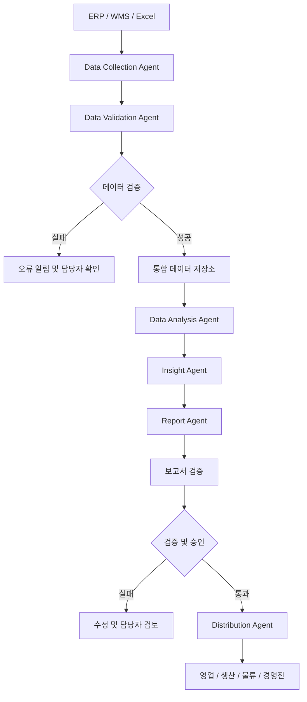

# [AI Agent 프로젝트] 기업 데이터 분석 및 보고 자동화 서비스 설계

> **프로젝트명:** Enterprise Data Intelligence Agent  
> **도메인:** Enterprise IT / Business Data Analytics  
> **주요 기술:** Python, Pandas, SQL, Google ADK, Gemini, RAG  
> **프로젝트 단계:** 아이디어 정의 및 업무 분석

---

## 1. 프로젝트 배경

### 1.1 나의 도메인 전문성

글로벌 제조·유통 기업 IT팀에서 근무하며 기업의 다양한 업무 시스템을 관리했습니다.

주요 경험은 다음과 같습니다.

- ERP, MES 등 기업 업무 시스템 관리
- 제조·영업·물류 시스템 간 데이터 연계
- IT 인프라 및 애플리케이션 운영
- 데이터 인터페이스 구축 및 관리
- 업무 프로세스 개선 및 IT 프로젝트 관리
- 글로벌 IT 조직과의 협업

이러한 경험을 통해 기업에서 데이터가 어떻게 생성되고, 여러 시스템을 거쳐 업무에 활용되는지 이해하게 되었습니다.

이번 AI Agent 교육과정에서는 기존 IT 경험과 AI 기술을 결합하여 실제 기업 업무에 적용할 수 있는 서비스를 설계하고자 합니다.

### 1.2 해결하고 싶은 문제

기업에는 다양한 업무 시스템이 존재합니다.

| 시스템 | 주요 데이터 | 활용 부서 |
|---|---|---|
| ERP | 매출, 주문, 구매, 재고 | 영업, 재무 |
| WMS | 입출고, 재고, 배송 | 물류, 영업 |
| CRM | 고객 정보, 영업 활동 | 영업, 마케팅 |
| Excel | 예산, 목표, KPI | 경영진, 각 부서 |

각 시스템에는 많은 데이터가 축적되지만, 실제 업무에서는 여러 시스템의 데이터를 별도로 추출하고 Excel로 가공하여 보고서를 만드는 경우가 있습니다.

이 과정에서 다음과 같은 문제가 발생할 수 있습니다.

1. 시스템별 데이터를 수동으로 추출해야 합니다.
2. 데이터 형식과 기준이 서로 달라 통합 작업이 필요합니다.
3. 매일 또는 매주 동일한 보고서를 반복 작성합니다.
4. 분석 결과를 부서별로 다시 가공해야 합니다.
5. 보고서 작성에 시간이 소요되어 데이터 활용이 지연됩니다.
6. 담당자마다 분석 기준이나 보고서 형식이 달라질 수 있습니다.

**핵심 문제**

> 기업의 여러 시스템에 분산된 데이터를 자동으로 수집·통합·분석하고, 각 부서에 필요한 정보를 적시에 제공할 수 없을까?

---

## 2. 프로젝트 목표

### 2.1 서비스 개요

**Enterprise Data Intelligence Agent**

기업 내 다양한 시스템에서 데이터를 수집하고 분석하여, 부서별로 필요한 보고서를 자동 생성하고 배포하는 AI Agent 기반 서비스입니다.

### 2.2 핵심 목표

- 데이터 수집 및 통합 업무 자동화
- 데이터 품질 검증 및 오류 탐지
- KPI 계산과 실적 분석 자동화
- AI 기반 분석 결과 해석 및 요약
- 부서별 맞춤형 보고서 생성
- 정기 보고서 배포 및 이상 징후 알림

### 2.3 AI Agent 도입 범위

모든 데이터 처리 작업을 AI Agent가 직접 수행하도록 설계하지는 않습니다.

정확한 수치 계산과 반복적인 데이터 처리는 Python, SQL 등의 프로그램으로 구현하고, AI Agent는 상황 판단과 분석 결과 해석, 보고서 작성 및 작업 흐름 조정에 활용합니다.

| 업무 | 처리 방식 |
|---|---|
| 데이터 추출 | Python / SQL |
| 데이터 정제 | Python / Pandas |
| 데이터 통합 | Python / SQL |
| KPI 계산 | Python / SQL |
| 분석 결과 해석 | AI Agent |
| 이상 징후 설명 | AI Agent |
| 보고서 작성 | AI Agent + Template |
| 보고서 배포 | AI Agent + 승인된 배포 도구 |
| 오류 발생 시 대응 | AI Agent + 담당자 확인 |

---

## 3. 컴퓨팅 사고 기반 업무 분해

### 3.1 분해 (Decomposition)

전체 업무를 7단계로 구분합니다.

| 단계 | 업무 | 세부 작업 |
|---|---|---|
| 1 | 데이터 수집 | ERP, WMS, Excel등 데이터 추출 |
| 2 | 데이터 검증 | 누락, 중복, 형식 오류 확인 |
| 3 | 데이터 통합 | 시스템별 데이터를 공통 기준으로 연결 |
| 4 | 데이터 분석 | KPI 계산, 추세 및 변동 분석 |
| 5 | AI 인사이트 생성 | 이상 징후 해석 및 주요 변화 요약 |
| 6 | 보고서 작성 | 부서별 맞춤형 보고서 생성 |
| 7 | 보고서 배포 | 지정된 수신자에게 자동 전달 |

### 3.2 패턴 인식 (Pattern Recognition)

기업 데이터 분석 업무에서 반복적으로 발생하는 패턴을 찾습니다.

**반복 업무 패턴**
- 매일 전일 매출 실적 취합
- 주간 매출 목표 달성률 분석
- 월간 제품별 매출 추이 분석
- 재고 부족 예상 제품 확인
- 생산 실적과 계획 대비 차이 분석
- 부서별 KPI 보고서 작성

**데이터 분석 패턴**
- 전일 대비 증감률
- 전주 및 전월 대비 변화
- 목표 대비 달성률
- 특정 기준을 벗어난 이상 수치
- 제품 및 고객별 실적 순위

이러한 공통 패턴을 기반으로 재사용 가능한 분석 로직을 구성합니다.

### 3.3 추상화 (Abstraction)

다양한 시스템의 데이터를 공통 구조로 표준화합니다.

| 공통 항목 | 설명 |
|---|---|
| Date | 데이터 기준일 |
| Department | 담당 부서 |
| Product ID | 제품 코드 |
| Product Name | 제품명 |
| Sales Amount | 매출액 |
| Sales Target | 매출 목표 |
| Inventory Qty | 재고 수량 |
| KPI Type | KPI 유형 |
| KPI Value | KPI 값 |

시스템마다 데이터 구조가 다르더라도 공통 항목으로 변환하면 동일한 분석 로직을 활용할 수 있습니다.

단, 매출 기준일, 매출 취소, 통화, 재고 기준 시점 등은 별도의 비즈니스 규칙으로 정의해야 합니다.

### 3.4 알고리즘 설계 (Algorithm Design)

1. 정해진 시간에 데이터 수집 작업을 실행합니다.
2. 시스템별 데이터를 추출합니다.
3. 데이터 누락 및 오류 여부를 검증합니다.
4. 오류가 있으면 담당자에게 알리고 해당 보고서 생성을 중단합니다.
5. 검증된 데이터를 통합 저장소에 적재합니다.
6. KPI와 주요 분석 지표를 계산합니다.
7. AI Agent가 분석 결과를 검토하고 주요 변화를 해석합니다.
8. 부서별 보고서 형식에 맞게 내용을 생성합니다.
9. 수치와 설명의 일치 여부를 검증합니다.
10. 지정된 수신자에게 보고서를 배포합니다.
11. 실행 결과와 오류 이력을 기록합니다.

---

## 4. AI Agent 상세 설계

서비스는 기능별로 역할을 구분한 Multi-Agent 구조를 목표로 합니다.

### 4.1 전체 아키텍처

초기 구현에서는 하나의 Orchestrator Agent가 각 기능을 순차적으로 호출하고, 이후 필요에 따라 개별 Agent로 분리할 계획입니다.

---

### 4.2 Agent 1: Data Collection Agent

**역할: 데이터 수집 및 실행 관리**

기업 내 여러 데이터 소스에서 필요한 데이터를 수집합니다.

**주요 작업**

1. 데이터 수집 일정 확인
2. 시스템별 데이터 연결 상태 확인
3. API, SQL 또는 파일 기반 데이터 추출
4. 데이터 수집 결과 확인
5. 수집 이력 및 오류 기록

**입력 데이터 예시**
- ERP 매출 데이터
- WMS 재고 데이터
- Excel 매출 목표 데이터

**출력 결과**
- 수집된 데이터 파일
- 수집 성공 및 실패 상태
- 수집 건수 및 실행 시간

**AI Agent의 역할**

- 실행 대상 데이터 소스 선택
- 사전에 정의된 수집 도구 호출
- 수집 실패 시 오류 유형 분류
- 오류 요약 및 담당자 알림

실제 데이터 연결과 추출은 Python 및 SQL 도구가 담당합니다.

---

### 4.3 Agent 2: Data Validation Agent

**역할: 데이터 품질 검증**

수집된 데이터가 분석에 적합한지 확인합니다.

**주요 작업**

- 필수 항목 누락 확인
- 중복 데이터 확인
- 데이터 형식 검증
- 기준일 일치 여부 확인
- 데이터 건수 및 합계 비교
- 비정상 수치 탐지

**검증 예시**

| 검증 항목 | 검증 규칙 | 오류 처리 |
|---|---|---|
| 제품 코드 | 필수값 존재 | 오류 목록 생성 |
| 매출 금액 | 숫자 형식 | 변환 실패 기록 |
| 거래번호 | 중복 여부 | 중복 검토 |
| 기준일 | 보고 기간과 일치 | 재수집 요청 |
| 데이터 건수 | 예상 범위 확인 | 담당자 알림 |

**AI Agent의 역할**

- 검증 결과 해석
- 오류 유형 분류
- 오류 발생 원인 후보 제시
- 담당자에게 수정 방법 추천

데이터 수정이나 삭제는 사전 승인된 규칙에 따라 수행하며, AI가 임의로 원본 데이터를 변경하지 않도록 합니다.

---

### 4.4 Agent 3: Data Analysis Agent

**역할: KPI 계산 및 데이터 분석**

검증된 데이터를 기반으로 주요 지표를 계산합니다.

**주요 작업**

1. 일별 매출 집계
2. 제품별 매출 분석
3. 매출 목표 달성률 계산
4. 전일 및 전월 대비 실적 비교
5. 재고 현황 분석
6. 이상 수치 탐지

**분석 지표 예시**

| KPI | 계산 방법 |
|---|---|
| 총매출 | 매출 금액 합계 |
| 목표 달성률 | 실적 / 목표 × 100 |
| 매출 증감률 | (현재 매출 - 비교 매출) / 비교 매출 × 100 |
| 재고 부족 여부 | 가용 재고와 기준 재고 비교 |
| 제품별 매출 비중 | 제품 매출 / 전체 매출 × 100 |

비교 기준이 0인 경우 등 예외 상황은 별도 규칙으로 처리합니다.

**AI Agent의 역할**

- 사용 목적에 맞는 분석 도구 선택
- 분석 기간 및 KPI 선택
- 분석 실행 결과 확인
- 추가 분석이 필요한 항목 식별

실제 수치 계산은 Python과 SQL로 처리하여 결과의 재현성과 정확성을 확보합니다.

---

### 4.5 Agent 4: Insight Agent

**역할: 데이터 분석 결과 해석**

수치 데이터를 사람이 이해하기 쉬운 비즈니스 인사이트로 변환합니다.

**주요 작업**

- 주요 KPI 변화 요약
- 매출 증가 및 감소 제품 식별
- 비정상적인 변화 설명
- 추가 확인이 필요한 항목 제안
- 부서별 주요 관심 사항 도출

**분석 예시 (가상 데이터)**

입력 데이터:

| 항목 | 전일 | 당일 | 증감률 |
|---|---:|---:|---:|
| 총매출 | 1억 원 | 8,500만 원 | -15% |
| 제품 A | 3,000만 원 | 2,100만 원 | -30% |
| 제품 B | 2,000만 원 | 2,400만 원 | +20% |

AI Agent 분석 결과 예시:

> 금일 총매출은 전일 대비 15% 감소했습니다.
>
> 제품 A의 매출이 30% 감소하여 전체 매출 하락에 영향을 주었습니다.
>
> 반면 제품 B는 20% 증가했습니다.
>
> 제품 A의 매출 감소 원인을 확인하기 위해 주문량, 재고 및 출고 현황을 추가로 검토할 필요가 있습니다.

**중요한 설계 원칙**

AI는 데이터에서 확인할 수 있는 사실과 추정 가능한 원인을 구분해야 합니다.

예를 들어 매출 감소가 확인되었다고 해서 재고 부족이 원인이라고 단정해서는 안 됩니다.

---

### 4.6 Agent 5: Report Agent

**역할: 부서별 맞춤형 보고서 작성**

동일한 분석 결과라도 부서별 업무 목적에 맞게 보고서를 생성합니다.

**영업 부서 보고서**
- 일별 매출 실적
- 목표 대비 달성률
- 주요 제품별 실적
- 매출 감소 제품
- 추가 확인 필요 항목

**물류 부서 보고서**
- 제품별 재고 현황
- 재고 부족 예상 품목
- 입출고 실적
- 출고 지연 현황
- 재고 관리 필요 항목

**경영진 보고서**
- 전체 매출 및 주요 KPI
- 목표 대비 실적
- 주요 변화 및 이상 징후
- 부서별 주요 이슈
- 의사결정이 필요한 사항

**보고서 출력 형식**
- Markdown
- HTML
- Excel
- PDF

초기에는 Markdown과 HTML 형식으로 구현하고 이후 Excel 및 PDF로 확장합니다.

---

### 4.7 Agent 6: Distribution Agent

**역할: 보고서 자동 배포 및 이력 관리**

완성된 보고서를 해당 부서의 수신자에게 전달합니다.

**주요 작업**

1. 보고서 유형 확인
2. 수신 부서 및 권한 확인
3. 배포 대상 목록 조회
4. 승인 여부 확인
5. 이메일 또는 협업 도구로 보고서 전달
6. 배포 결과 기록
7. 전송 실패 시 재시도 또는 담당자 알림

**배포 예시**

| 보고서 | 수신 부서 | 주기 |
|---|---|---|
| 일일 매출 실적 | 영업 | 매일 |
| 재고 현황 | 물류 | 매일 |
| 생산 KPI | 생산 | 매주 |
| 경영 실적 요약 | 경영진 | 매월 |

**보안 고려사항**

- 부서별 데이터 접근 권한 확인
- 개인정보 및 민감 정보 마스킹
- 사전 등록된 수신자에게만 배포
- 보고서 배포 이력 기록
- 외부 전송 시 승인 절차 적용

---

## 5. AI Agent 간 작업 흐름

예를 들어 매일 오전 8시에 영업 실적 보고서를 생성하는 상황을 가정합니다.

| 순서 | 실행 주체 | 작업 |
|---|---|---|
| 1 | Scheduler | 오전 8시 작업 시작 |
| 2 | Collection Agent | ERP 매출 데이터 수집 |
| 3 | Collection Agent | WMS 재고 데이터 수집 |
| 4 | Validation Agent | 데이터 품질 검증 |
| 5 | Analysis Agent | 매출 및 재고 KPI 계산 |
| 6 | Insight Agent | 주요 실적 변화 분석 |
| 7 | Report Agent | 영업 부서 보고서 작성 |
| 8 | Validation Tool | 보고서 수치 및 내용 검증 |
| 9 | Distribution Agent | 승인된 수신자에게 배포 |
| 10 | Logging | 실행 결과 기록 |

### 예외 처리

- 데이터 수집 실패 → 재시도 후 담당자 알림
- 데이터 품질 오류 → 해당 보고서 생성 중단
- KPI 계산 실패 → 오류 기록 및 분석 중단
- AI 분석 결과 불확실 → 추가 검토 요청
- 보고서 검증 실패 → 배포 차단
- 보고서 전송 실패 → 재시도 및 담당자 알림

---

## 6. 예상 기술 아키텍처

| 구성 요소 | 기술 | 활용 목적 |
|---|---|---|
| 개발 언어 | Python | 전체 서비스 구현 |
| 데이터 처리 | Pandas | 데이터 정제 및 분석 |
| 데이터 저장소 | SQLite / PostgreSQL | 통합 데이터 저장 |
| AI 모델 | Gemini | 분석 결과 해석 |
| Agent Framework | Google ADK | Agent 구성 및 실행 |
| 지식 검색 | RAG | KPI 정의 및 업무 규칙 검색 |
| 사용자 화면 | Streamlit | 보고서 조회 및 실행 |
| 시각화 | Plotly | KPI 차트 생성 |
| 스케줄링 | APScheduler | 정기 실행 |
| 보고서 배포 | Email API | 보고서 전달 |

### RAG 활용 방안

RAG는 단순한 데이터 집계보다는 기업의 업무 규칙과 KPI 정의를 검색하는 데 활용합니다.

예를 들어 다음과 같은 문서를 검색 대상으로 구성할 수 있습니다.

- 매출 실적 산정 기준
- 재고 관리 정책
- KPI 정의서
- 부서별 보고서 작성 기준
- 업무 프로세스 및 운영 매뉴얼

AI Agent는 이러한 문서를 참조하여 분석 결과를 일관된 기준으로 설명하도록 설계합니다.

---

## 7. 단계별 개발 계획

교육과정 내에서 구현 가능한 범위를 고려하여 개발 단계를 구분합니다.

### Phase 1. MVP 구현

**목표: 매출 데이터 분석 및 보고서 자동 생성**

- [ ] 가상 ERP 매출 데이터 생성
- [ ] CSV 및 Excel 데이터 읽기
- [ ] 데이터 정제 및 품질 검증
- [ ] 매출 KPI 계산
- [ ] Google ADK 기반 Agent 구성
- [ ] Gemini를 활용한 분석 결과 요약
- [ ] Markdown 보고서 자동 생성

**완료 기준**

사용자가 분석을 요청하면 AI Agent가 데이터를 분석하고 주요 KPI 및 분석 결과를 포함한 보고서를 생성할 수 있어야 합니다.

### Phase 2. 다중 데이터 통합

**목표: 매출과 재고 데이터 통합 분석**

- [ ] WMS 재고 데이터 추가
- [ ] 제품 코드 기준 데이터 통합
- [ ] 재고 부족 제품 탐지
- [ ] 매출과 재고의 연관 분석
- [ ] 영업 및 물류 보고서 구분

### Phase 3. 자동 배포

**목표: 정기 보고서 생성 및 배포**

- [ ] 정기 실행 스케줄 구성
- [ ] 부서별 보고서 템플릿 작성
- [ ] 수신자 관리 기능
- [ ] 이메일 배포 기능
- [ ] 실행 이력 및 오류 로그 관리

### Phase 4. 서비스 고도화

**목표: 실제 기업 환경을 고려한 확장**

- [ ] ERP 및 업무 시스템 API 연계
- [ ] RAG 기반 업무 규칙 검색
- [ ] 이상 징후 자동 알림
- [ ] 자연어 기반 데이터 질의
- [ ] 대시보드 구축
- [ ] 접근 권한 및 승인 체계 강화

---

## 8. 검증 기준

### 8.1 기능 검증

| 검증 항목 | 목표 |
|---|---|
| 데이터 수집 | 지정된 데이터 정상 수집 |
| 데이터 검증 | 사전에 정의한 오류 사례 탐지 |
| KPI 계산 | 기준 데이터와 계산 결과 일치 |
| AI 분석 | 제공된 데이터에 근거한 설명 |
| 보고서 생성 | 필수 KPI 및 분석 내용 포함 |
| 자동 배포 | 승인된 수신자에게만 전달 |
| 오류 처리 | 오류 기록 및 적절한 알림 |

### 8.2 성능 및 품질 측정

MVP 구현 후 다음 항목을 측정합니다.

- 수작업 대비 보고서 작성 시간
- 데이터 처리 성공률
- KPI 계산 정확도
- AI 분석 결과의 사실 일치율
- 보고서 생성 성공률
- 부서별 보고서 활용 가능성

### 8.3 최종 검증 기준

> 10년 이상 경력의 기업 IT 관리자 또는 데이터 분석 담당자가 검토했을 때, 실제 업무에 적용할 가능성이 있고 데이터 정확성, 운영 효율성, 정보보안을 고려한 설계라고 평가할 수 있어야 합니다.

---

## 9. 기대 효과

### 업무 효율성 향상

반복적인 데이터 추출, 취합 및 보고서 작성 업무를 자동화하여 담당자가 분석과 의사결정 지원에 더 많은 시간을 활용할 수 있습니다.

### 데이터 활용도 향상

서로 다른 시스템의 데이터를 통합하여 개별 시스템만으로 확인하기 어려운 업무 현황을 파악할 수 있습니다.

### 보고서 표준화

동일한 KPI 정의와 보고서 템플릿을 적용하여 보고서의 일관성을 높일 수 있습니다.

### 신속한 의사결정 지원

주요 KPI 변화와 이상 징후를 신속하게 파악하여 필요한 부서에 전달할 수 있습니다.

### 기업 지식의 재활용

KPI 정의와 업무 규칙을 지식 문서로 관리하여 분석 과정에 반복적으로 활용할 수 있습니다.

---

## 10. 프로젝트를 통해 배우고 싶은 것

이번 프로젝트를 통해 단순히 LLM API를 호출하는 것을 넘어, AI Agent가 실제 기업 업무 프로세스에서 어떤 역할을 수행할 수 있는지 경험하고자 합니다.

특히 다음과 같은 역량을 확보하는 것이 목표입니다.

1. 기업 업무를 AI Agent 관점에서 분석하는 능력
2. Python 기반 데이터 처리 및 분석 구현 능력
3. Google ADK를 활용한 Agent 개발 능력
4. AI와 기존 업무 시스템을 연계하는 설계 능력
5. AI 결과의 신뢰성과 업무 통제를 고려하는 능력

---

## 11. 마무리

이번 프로젝트는 기존의 기업 IT 관리 경험을 AI 기술과 결합하는 첫 번째 시도입니다.

기업에서 발생하는 데이터를 단순히 수집하고 저장하는 것을 넘어, AI Agent가 분석 결과를 해석하고 필요한 부서에 적절한 정보를 제공하는 서비스를 구현하고자 합니다.

처음에는 매출 데이터 분석 및 보고서 생성이라는 작은 기능부터 시작하고, 점진적으로 데이터 통합, 이상 징후 분석, 부서별 자동 배포 기능으로 확장할 계획입니다.

**최종 목표는 기업 데이터를 실질적인 비즈니스 인사이트로 전환하는 AI Agent 서비스를 만드는 것입니다.**

